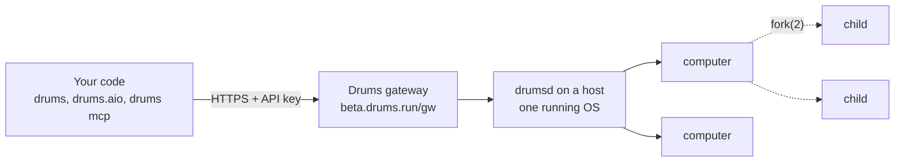

<p align="center">
  <picture>
    <source media="(prefers-color-scheme: dark)" srcset="https://raw.githubusercontent.com/Drums-Labs/drums-python-sdk/main/docs/assets/drums-symbol-light.svg">
    
  </picture>
</p>

<h1 align="center">drums-python-sdk</h1>

<p align="center">
  Python SDK and MCP server for <a href="https://drums.run">Drums</a>: create, act on, fork, reset and verify isolated desktops for computer-use agents.
</p>

<p align="center">
  <a href="https://pypi.org/project/drums-sdk/"></a>
  <a href="https://pypi.org/project/drums-sdk/"></a>
  <a href="LICENSE"></a>
  <a href="https://github.com/Drums-Labs/drums-python-sdk/actions/workflows/ci.yml"></a>
  <a href="https://github.com/Drums-Labs/drums-python-sdk/actions/workflows/release.yml"></a>
  <a href="https://console.drums.run/docs"></a>
</p>

<p align="center">
  <a href="https://drums.run">Website</a> ·
  <a href="https://console.drums.run/docs">Docs</a> ·
  <a href="https://bench.drums.run">Benchmarks</a> ·
  <a href="https://console.drums.run">Console</a> ·
  <a href="https://console.drums.run/docs/reference/python-sdk">SDK reference</a> ·
  <a href="CHANGELOG.md">Changelog</a>
</p>

## What it is

Drums runs many isolated desktops on one host by sharing one running operating system and its applications while
keeping each desktop's mutable state separate. A desktop (a *computer*) can be created from a template in seconds,
acted on with GUI, shell and file actions, saved, forked into N copies of the same state, reset, and scored with a
task's checker. Every episode carries a validity verdict, so a score from a broken environment never reaches training.

This repository is the Python client for that runtime and the `drums` command. The package on PyPI is `drums-sdk`;
the import name is `drums`. It uses only the standard library and supports Python 3.9 and later. It talks to Drums
Cloud (`https://beta.drums.run/gw`) or to a self-hosted `drumsd` over the same HTTP API.

## Install

```bash
pip install drums-sdk
```

## Quickstart

Sign in at [console.drums.run](https://console.drums.run), open **API Keys** and create a key. It starts with
`drums_sk_` and is shown once. Then, in a terminal:

```bash
export DRUMS_URL=https://beta.drums.run/gw
export DRUMS_TOKEN=drums_sk_...
```

Save this as `quickstart.py` and run it with `python quickstart.py`. It starts a desktop with OSWorld task
`e0df059f` (rename a folder on the Desktop), saves a screenshot, performs one GUI action and one shell action, runs
the task's checker and closes the desktop.

```python
import drums

with drums.connect() as client:                                   # reads DRUMS_URL and DRUMS_TOKEN
    with client.create(task="e0df059f", ttl=900) as env:         # OSWorld task id; ttl: lifetime in seconds
        env.wait_valid()                                          # every gate of this episode passed
        open("screen.png", "wb").write(env.screenshot())          # PNG, 1920x1080
        env.step("pyautogui.click(960, 540)")                     # GUI: pyautogui code runs inside the desktop
        env.step({"type": "execute", "shell": True,
                  "command": "mv ~/Desktop/todo_list_Jan_1 ~/Desktop/todo_list_Jan_2"})
        reward = env.verify(strict=False)                         # the task's checker plus the episode's validity
        print("score", reward.score, "valid", reward.valid, reward.invalid_reasons)
    print("computers left:", len(client.envs()))                  # 0: the with-block destroyed it
```

Expected output:

```text
score 1 valid True []
computers left: 0
```

Use a score only when `valid` is `True`. With the default `strict=True`, `verify()` raises `drums.InvalidEpisode`
for an invalid episode instead of returning a reward. A `401` raises `drums.AuthError`: the key is mistyped,
revoked or expired. The full walkthrough is the [docs quickstart](https://console.drums.run/docs/quickstart).

## How it works



The SDK is a thin client of the gateway's `/v1` routes ([HTTP API](https://console.drums.run/docs/reference/http-api)).
A `Client` creates computers and lists them; an `Env` is one computer: it steps, screenshots, saves, forks, resets
and verifies. Names differ between the SDK and the raw API: a computer is a *slot*, a saved state a *checkpoint*,
save is *capture* and fork is *branch*. They are the same things.

- **Cleanup.** `with drums.connect() as client:` closes every computer the client created when the block ends, and so
  do process exit and SIGTERM/SIGHUP. Computers and saved states also have server-side leases (default: reaped after
  30 minutes unused), so a crashed trainer does not hold a host.
- **Validity.** Every episode starts with a gate report (isolation, mounts, network, limits, state hash, processes
  alive after resume). `Reward.valid` is `True` only when every gate passed and the computer was never quarantined.
- **Retries.** GET requests are retried while the server is unreachable (up to `retry_s`, default 60 s). POST and
  DELETE are never retried: after a lost reply the outcome is unknown, so check `client.envs()` before trying again.

## Computers

```python
import drums

client = drums.connect()

env = client.create(task="e0df059f", ttl=900)      # from the default template, with an OSWorld task
env = client.create(image="osworld-ubuntu")        # a template, no task; env.load_task(...) later
envs = client.create_many(8, task="e0df059f")      # 8 computers created concurrently

state = env.save()                                 # a saved state; the computer keeps running
again = client.create(from_state=state)            # a new computer from that state
client.delete_state(state)                         # once no computer uses it

kids = env.fork(4, keep_state=False)               # 4 children from this exact state; the parent keeps running
print(kids.state, [k.id for k in kids])            # the state the fork made, and the children
kids.close()                                       # close all children

env.reset()                                        # back to the template or saved state; the task's setup runs again
env.close()                                        # destroy; a no-op if it is already gone
```

`create` takes `idle_timeout` and `ttl` (seconds) for the computer's lease; `fork` and `save` take the same for
the children and the state. `fork` captures the state right after an action without a sleep: it waits until the
process tree is quiescent and raises `drums.NotQuiescent` if it cannot within `quiesce_timeout`. `env.prefork(n)`
prepares the next fork in the background. Guides: [snapshots and forks](https://console.drums.run/docs/concepts/snapshots-and-forks),
[group rollouts with fork](https://console.drums.run/docs/guides/group-rollouts-with-fork).

## Actions

`env.step(action)` runs one action inside the desktop as its user (not root) and returns a `StepResult`. The screen
is 1920x1080 with the origin top left.

```python
env.step("pyautogui.click(100, 200)")                                 # a str is pyautogui code
env.step("pyautogui.write('hello'); pyautogui.hotkey('ctrl', 's')")
env.step({"type": "execute", "shell": True, "command": "ls ~/Desktop"})  # a shell command, waits for it
env.step({"type": "launch", "shell": True, "command": "gedit &"})       # start a program, do not wait
env.step({"type": "sleep", "seconds": 2})

r = env.step("pyautogui.click(960, 540)", screenshot=True)            # the screenshot after the action
r.observation.png                                                     # PNG bytes
r = env.step({"type": "execute", "command": "test -f ~/x", "shell": True}, check=False)
r.result["returncode"]                                                # 1 here; check=True would raise ActionFailed
```

An action that ran and exited non-zero raises `drums.ActionFailed` (with `returncode`, `output`, `error`);
`check=False` returns the result instead. `env.observe()` returns an `Observation` (PNG plus task, episode and
verdict metadata). `drums.hybrid.HybridTools(env)` adds `shell`, `read_file`, `write_file`, `list_dir`,
`office_convert`, `spreadsheet_read`, `browser_tabs` and `browser_open` over the same computer, with `TOOLS` as
their JSON schema. Reference: [actions](https://console.drums.run/docs/concepts/computers-and-templates#actions).

## Verify and the `trusted` flag

```python
reward = env.verify(strict=False)
reward.score            # the checker's score (1 or 0 for OSWorld tasks), None if the checker did not run
reward.valid            # True only when every gate of the episode passed and the computer was never quarantined
reward.invalid_reasons  # why not, in words (empty when valid)
reward.trusted          # True, False or None (see below)
reward.audit_flags      # e.g. ["scope"], ["checker_timeout"]
```

`valid` is about the environment; `trusted` is about the reward. After the checker runs, drumsd audits the result
(a recheck, a redundant checker where one exists, a scope check that flags reward hacking, checker timeout or crash).
`trusted` is `True` only for a valid episode with a score and no audit flag. It is `False` when a flag was raised and
`None` when the server sent no audit (an older runtime), never `True` by default. Train on `score` when `valid` is
`True`; prefer `trusted` when it is available.

With `strict=True` (the default), `verify()` raises `drums.InvalidEpisode` for an invalid episode and
`drums.CheckerError` when the checker failed; both carry the `Reward`. Tasks and checkers:
[tasks and verifiers](https://console.drums.run/docs/concepts/tasks-and-verifiers).

## Runs

A run is a managed batch on the Drums gateway: a set of tasks played on desktops, every attempt verified and
recorded, stopped at a spend or time cap. Runs are created in the console (**Runs > New run**); the SDK reads them
and can submit the same request the wizard's review step shows.

```python
page = client.runs(kind="scripted_test", status="completed", limit=20)
for run in page["items"]:
    print(run["id"], run["status"], run.get("stop_reason"))

run = client.run(page["items"][0]["id"])            # status, counts and events of one run
new = client.create_run(spec, idempotency_key="nightly-2026-11-13")   # spec: the request the console shows
```

Runs, evaluations, API keys and the audit log exist on the Drums gateway only; against a plain `drumsd` these
methods raise `drums.NotFound`. Concepts: [runs and evaluations](https://console.drums.run/docs/concepts/runs-and-evaluations).

## MCP

Drums publishes one MCP server with 34 tools: the workspace (computers, snapshots, tasks, runs, API keys, audit log)
and the desktop itself (GUI, screenshot, shell, files, verify, fork, reset). Two ways to reach it:

| Transport | Where it runs | Address |
|---|---|---|
| Remote (Streamable HTTP) | inside the gateway | `https://beta.drums.run/gw/mcp` |
| Local (stdio) | `drums mcp` from this package | your machine, talking to `DRUMS_URL` with `DRUMS_TOKEN` |

Both list exactly the same tools with the same schemas (`drums/mcp_tools.json`). Authentication is the workspace
API key in either case; there is no OAuth flow. `drums mcp --print-config` prints the snippet for each client with
a placeholder key, never a real one:

```bash
export DRUMS_URL=https://beta.drums.run/gw
drums mcp --print-config claude
```

```text
claude mcp add --transport http drums https://beta.drums.run/gw/mcp --header "Authorization: Bearer drums_sk_..."
```

```bash
drums mcp --print-config cursor      # ~/.cursor/mcp.json or .cursor/mcp.json
```

```json
{"mcpServers": {"drums": {"url": "https://beta.drums.run/gw/mcp", "headers": {"Authorization": "Bearer drums_sk_..."}}}}
```

```bash
drums mcp --print-config codex       # ~/.codex/config.toml; Codex starts the local server
```

```toml
[mcp_servers.drums]
command = "drums"
args = ["mcp"]
env = { DRUMS_URL = "https://beta.drums.run/gw", DRUMS_TOKEN = "drums_sk_..." }
```

`drums mcp --print-config claude-local` prints the Claude Code line for the local server. Replace `drums_sk_...`
with your key. Treat the client's configuration file like a secret.

The local server:

```bash
drums mcp                        # all tools; desktop tools take computer_id
drums mcp --env COMPUTER_ID      # desktop tools default to this computer
drums mcp --create               # create one computer, bind it, close it on exit (--task FILE loads a task)
```

`drums mcp` is the same as `python -m drums.mcp`. The token comes from `DRUMS_TOKEN`, else the file named by
`DRUMS_TOKEN_FILE`, else `/etc/drums/token`; it is never printed and never appears in an error message. This
repository is also a Claude Code plugin (`.claude-plugin/plugin.json`, `.mcp.json`, the `drums-workflow` skill).

Two rules:

- **`confirm: true`.** `destroy_computer`, `delete_snapshot` and `revoke_api_key` (the tools marked `destructive`
  in `mcp_tools.json`) are refused before any request is sent unless the tool arguments carry `confirm: true`. The
  caller (the agent) supplies that argument; Drums does not prompt anyone. Whether a person approves the call is the
  MCP client's job (Claude Code, Cursor and Codex each have tool-approval settings). `reset` discards a computer's
  desktop state too, but it is not gated.
- **HTTPS only.** The token travels over HTTPS, or over plain HTTP to loopback only (`localhost`, `127.0.0.0/8`,
  `::1`, where a local `drumsd` listens). Any other `http://` URL in `--url` or `DRUMS_URL` is refused before a
  request is sent (`drums.InsecureTransport`; exit 2 from `drums mcp`), with a message naming the host and the
  opt-ins, never the token. To opt in: `drums mcp --allow-insecure-http`, `DRUMS_ALLOW_INSECURE_HTTP=1`, or
  `drums.connect(url, token, allow_insecure_http=True)`. Redirects are followed only to the same origin, at most 5
  hops, with the same check on every hop (`drums.RedirectRefused` otherwise).

Tool list, scopes and examples: [MCP guide](https://console.drums.run/docs/guides/mcp).

## Async client

`drums.aio` offers the same calls as coroutines. Each `AsyncClient` has its own thread pool (default 1024 threads,
started on demand), so N computers driven with `asyncio.gather` really run N calls at once.

```python
import asyncio

import drums.aio


async def main():
    async with await drums.aio.connect() as client:
        envs = await asyncio.gather(*[client.create(task="e0df059f") for _ in range(8)])
        await asyncio.gather(*[e.step("pyautogui.click(960, 540)") for e in envs])
        rewards = await asyncio.gather(*[e.verify(strict=False) for e in envs])
        print([r.score for r in rewards if r.valid])


asyncio.run(main())
```

## Errors

Every failure is a typed exception under `drums.DrumsError` with `status` (the HTTP status, `0` when there was no
reply), `message` and `body`. Errors about a computer carry its record and gate report.

| Exception | When |
|---|---|
| `AuthError` | 401: missing, wrong, revoked or expired key |
| `InsecureTransport` | refused before any request: a token would travel over plain HTTP off loopback |
| `RedirectRefused` | refused: a redirect to another origin, or more than 5 hops |
| `BadRequest` | 400 or 422: bad task JSON, bad id, `n` out of range |
| `TaskUnsupported` | 422: the task needs the agent itself to act as root; nothing was started |
| `NotFound` | 404: no such computer, template, state or task |
| `EnvGone` | 410: the computer was destroyed (closed, or reaped by its lease); a subclass of `NotFound` |
| `Conflict` | 409: the computer's state does not allow this operation |
| `NotQuiescent` | 409: fork or save found no safe moment to capture; nothing was captured |
| `CheckpointStale` | 409: the template's checkpoint predates this runtime; the installer must run again |
| `Overloaded` | 429: the host is near its memory limit; nothing was started, try again later |
| `DaemonUnavailable` | the server did not answer; after a POST, call `env.refresh()` |
| `GuestError` | 502: the desktop's guest did not answer or refused the action |
| `ActionFailed` | the action ran and exited non-zero (`returncode`, `output`, `error`) |
| `EnvFailed` | a create, reset or fork child did not come up ready (`record`, `gates`, `cause`) |
| `RestoreFailed`, `GateFailed`, `TaskSetupFailed` | subclasses of `EnvFailed`: restore failed, a gate failed (quarantined), the task's setup failed |
| `ForkError` | some children failed (`ok`, `failed`, `state`) |
| `BatchError` | some of `create_many` failed (`ok`, `failed`) |
| `InvalidEpisode` | `verify()` on an invalid episode (`reward` attached); do not train on it |
| `CheckerError` | the checker raised or could not run (`reward` attached) |

Every gateway error reply carries a `request_id` (`gw_...`); include it when you report a problem. Full table with
causes and fixes: [errors](https://console.drums.run/docs/reference/errors).

## Configuration

| Variable | Read by | Meaning |
|---|---|---|
| `DRUMS_URL` | SDK, `drums mcp` | the gateway or `drumsd` URL. Default `http://127.0.0.1:7070` |
| `DRUMS_TOKEN` | SDK, `drums mcp` | the API key (`drums_sk_...`); sent as `Authorization: Bearer` |
| `DRUMS_TOKEN_FILE` | `drums mcp` | a file holding the token, read when `DRUMS_TOKEN` is unset; then `/etc/drums/token` |
| `DRUMS_ALLOW_INSECURE_HTTP` | SDK, `drums mcp` | `1` sends the token over plain HTTP to a host that is not loopback |
| `DRUMSD_URL` | SDK | older name for `DRUMS_URL`, read when `DRUMS_URL` is unset |

`drums.connect(url, token, timeout=900, retry_s=60, check=True, close_on_exit=True, handle_signals=True,
allow_insecure_http=None)` takes the same values as arguments. In CI, store the key in the secret store and expose
it only as `DRUMS_TOKEN` to the job that needs it ([API keys guide](https://console.drums.run/docs/guides/api-keys)).

## Development

```bash
git clone https://github.com/Drums-Labs/drums-python-sdk.git
cd drums-python-sdk
python3 -m unittest discover -s tests -v
```

The tests run against a fake gateway on `127.0.0.1` and need no account or network. CI runs them on Python 3.9,
3.10, 3.11, 3.12 and 3.13 on every push and pull request, then builds the package and runs `twine check --strict`;
the release workflow installs the built wheel into a clean venv on the same five versions and runs the suite against
it. To do the same locally:

```bash
python3 -m pip install --upgrade build twine
python3 -m build
python3 -m twine check --strict dist/*
```

Please read [CONTRIBUTING.md](CONTRIBUTING.md) before opening a pull request.

## Versioning and changelog

Versions follow `MAJOR.MINOR.PATCH`. While the major version is 0, a minor release may change an interface and says
so in [CHANGELOG.md](CHANGELOG.md), which lists every release with the runtime version it was built against. The
package version is `drums.__version__`; `drums version` prints it. Releases are tagged `vX.Y.Z` and published to
PyPI by the [release workflow](.github/workflows/release.yml) with Trusted Publishing; see [RELEASE.md](RELEASE.md).

## Security

Report a vulnerability privately through
[GitHub's private reporting form](https://github.com/Drums-Labs/drums-python-sdk/security/advisories/new) or to
security@drums.run, not in a public issue. [SECURITY.md](SECURITY.md) has the supported versions, the response time
and the known limitations of the runtime the SDK talks to.

## Contributing

Bug reports and pull requests are welcome. [CONTRIBUTING.md](CONTRIBUTING.md) covers the setup, the tests, the
sign-off and what a pull request needs. The project follows the [Contributor Covenant](CODE_OF_CONDUCT.md).

## License

[Apache License 2.0](LICENSE).

## Status

Beta. The `Client` and `Env` methods used in this README, the error classes and the environment variables are
stable within 0.x: a change to any of them is listed in the changelog with a migration note. Stable: create, step,
observe, screenshot, save, fork, reset, verify, close; the MCP tool list and its `confirm` rule; the transport
rules. Not yet stable: `Client.runs`/`create_run` (the gateway's run endpoints are new), `HybridTools` (the browser
tools need Chrome started with a DevTools port), and `Reward.trusted` on runtimes that send no audit (it is `None`
there).
